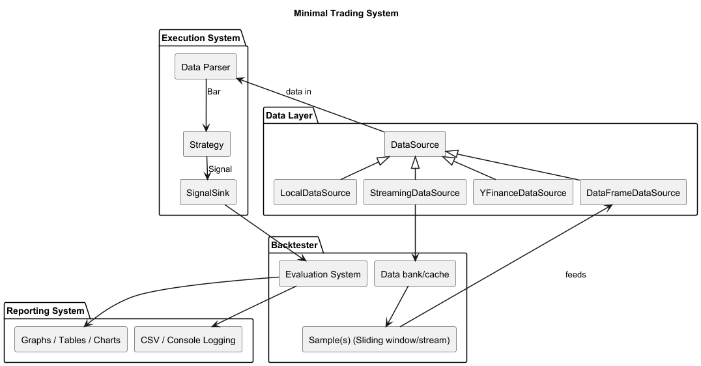
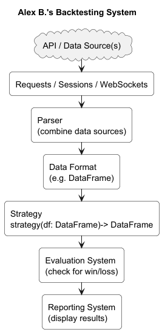

# System Overview

## Tom's System Notes

### Rough components of system
- Signal generation system
  - Watch market & flag when to trade
- Risk management system
  - Monitor open & proposed positions
  - value at risk? xccy hedge?
- Order management system
  - take an order and split it into multiple orders to be executed at different brokers (or one! although they may not always have volume)
  - Broker (that can simulate matching orders)
- Market data system
  - Collate & manage market data
  - Maybe generate fake data for backtesting as well?
- Testing system
  - Backtesting
  - Forward testing
  - Stats (sharpe, drawdown etc etc)
- Interface
  - Dashboard
  - Strategy interaction
  - Testing interaction
  - Risk interaction

### Version 1 for Backtesting (MVP)
- [x] DataFrame based dumb iterative testing over static data
- [x] Fetch
  - [x] Fetch data from a library
  - [x] Download as DataFrame
- [x] Test
  - [x] Strategy as a separate .py file with some logic (let's say simple moving average, buy at -2% & sell at +2%
  - [ ] Pass each bar to a simple moving average that calculates last value
  - [x] Pass each bar to trading logic, which decides whether to buy or sell
  - [x] Issue an order (market order to start with, move onto limit later)
- [x] Execute
  - [x] Add a broker to match orders
    - [ ] Probably pass it with a call instead of matching later on

### Component Diagram
<p align="center">
  
  <br>
  <em>Figure 1: Minimal Backtesting & Execution System.</em>
</p>

### Alex B.'s Diagram (slightly modified)
<p align="center">
  
  <br>
  <em>Figure 2: Alex B.'s System Diagram.</em>
</p>

# Current System Overview
The main idea of the current system is to enforce a clear separation of concerns between different components of the
trading system. As for example, the Strategy component should not be concerned with parsing data or handling `DataFrame`
objects, and only needs to consider individual bars/candles of market data. Risk management converts signals into sized 
orders, and a broker (simulated or real) handles execution and fills.

## 1 System Components
- Main (e.g. `examples/example_main.py`)
  - Instantiates and links all components and begins execution.
    - Strategy class (e.g. `examples/example_strategy.py`)
      - Inherits from abstract Strategy base class (`ghosalquant` -> `Strategy` class)
        - Implements:
          - `on_start() -> None`: Called by the `ExecutionSystem` before receiving any market data.
          - `on_market_data(bar: Bar) -> Signal | None`: Called by the `ExecutionSystem` for each individual `Bar`
          received from a `DataSource`. Returns a `Signal` or `None`.
          - `on_end() -> None`: Called after all market data has been processed.
        - Provides a built-in `calculate_quantity(confidence) -> float | None` helper that linearly maps confidence to
          a quantity between `min_qty` and `max_qty` (configurable via the constructor).
    - (Optionally) Backtester (e.g. `ghosalquant.backtester.backtester_base` -> `Backtester` class)
      - Can be created directly or from a config file via the `Backtester.from_config()` class method.
      - Orchestrates the full backtesting pipeline: wires together a `DataSource`, `ExecutionSystem`, `Portfolio`,
        `RiskManager`, and optionally a `SignalSink`.
      - Implements:
        - `run() -> BacktestKPMs`: Synchronous entry point. Runs the backtest and returns key performance metrics.
        - `async run_async() -> BacktestKPMs`: Async entry point for use within an existing event loop.
      - Exposes post-run properties: `equity_curve`, `realised_pnl`, `unrealised_pnl`, `total_pnl`, `kpms`.
    - `DataFrameBacktester` (from `ghosalquant.backtester.dataframe_backtester`)
      - Subclass of `Backtester` tailored for `pandas.DataFrame` input.
      - Wraps the DataFrame in a `DataFrameDataSource` and attaches a `DataFrameSink` to record signals back onto the
        DataFrame.
      - Exposes a `dataframe` property returning the annotated DataFrame with signal/confidence/quantity columns.
    - Data source (e.g. `ghosalquant.data_layer.yfinance_datasource` -> `YFinanceDataSource`)
      - Inherits from abstract `DataSource` base class (`ghosalquant.data_layer.datasource_base`).
        - Implements:
          - `async __aiter__() -> AsyncIterable[Bar]`: Yields `Bar` instances asynchronously.
    - Execution system (`ghosalquant.execution.execution_system` -> `ExecutionSystem` class)
      - Takes `DataSource`, `Strategy`, and optionally `SignalSink`, `RiskManager`, `Portfolio`, and `Broker`.
      - Validates that a `Portfolio` is always accompanied by a `RiskManager` and a `Broker`.
      - Implements:
        - `async run() -> None`: Main loop of the execution system.
          - Connects the broker (if present).
          - Calls `strategy.on_start()`.
          - For each `Bar` from the `DataSource`:
            - Passes the bar to the `Broker` so simulation brokers can advance market state.
            - Updates portfolio equity from the bar.
            - Collects fills from the broker and passes them to the portfolio.
            - Calls `strategy.on_market_data(bar)` to get a `Signal`.
            - Forwards non-`None` signals to the `SignalSink` chain (if present).
            - Passes the signal through the `RiskManager` to produce an `Order`.
            - Submits the order to the `Broker`.
          - Calls `strategy.on_end()` and disconnects the broker on completion or interruption.
    - Signal sink (e.g. `ghosalquant.execution.sinks` -> `SignalSink` protocol)
      - Implements:
        - `async on_signal(signal: Signal) -> None`: Called by the `ExecutionSystem` to handle signals generated by
          the `Strategy`.
    - Risk manager (`ghosalquant.risk.risk_manager` -> `RiskManager`)
      - Converts a `Signal` into an `Order` (or `None` if blocked) by running a chain of `RiskRule`s against a
        mutable `OrderDraft`.
    - Portfolio (`ghosalquant.portfolio.portfolio_base` -> `Portfolio` protocol)
      - Tracks open/closed trades, equity curve, and PnL from broker fills.
    - Broker (`ghosalquant.brokerage.broker_base` -> `Broker` ABC)
      - Receives `Order`s and produces `Fill`s.

### 1.1 Data Flow
The flow of information through the current system is as follows:

```
DataSource -> MarketEvent -> ExecutionSystem -> Strategy -> Signal(s)
              (Bar |                                           |
               OrderBook |                                     +-> SignalSink chain (optional, e.g. PrintSink, DataFrameSink)
               PublicTrade)                                    |
                                                               +-> RiskManager -> Order -> Broker -> Fill -> Portfolio
```

A `DataSource` yields `MarketEvent`s: `Bar`s, `OrderBook`s, and `PublicTrade`s in any mix. For every event the
`ExecutionSystem`:
0. Expires any resting order whose time to live ran out before this event, calling
   `Strategy.on_order_expired(order, broker_order_id, expired_at, context)`. A broker only reaches a symbol when
   that symbol has an event, so without this an order stays visible long after the venue would have cancelled it.
1. Passes the event to the `Broker` (`on_bar` / `on_order_book` / `on_public_trade`). A simulation broker may return
   an adjusted view of an order book for the strategy to see.
2. Marks the `Portfolio` from the **raw** event: a bar's close, a two-sided book's mid (or bid/ask under
   `MarkPolicy.CONSERVATIVE`), or a print. A one-sided book leaves the previous mark in place. Bars snapshot equity
   every time; books and prints snapshot at most once per `snapshot_interval` (and whenever a fill changed the
   accounting), so a high-frequency book feed does not bloat the equity curve.
3. Records the bar close in `price_history` (bars only — the risk rules read it as a bar series).
4. Drains any new `Fill`s from the `Broker`, feeds them into the `Portfolio`, and calls `Strategy.on_fill`.
5. Dispatches the event to `on_market_data(bar)`, `on_order_book(book, context)`, or `on_public_trade(trade, context)`
   and passes each resulting `Signal` through the sinks and the `RiskManager`; accepted orders are reported back
   through `Strategy.on_order_accepted(order, broker_order_id)`.

The `RiskContext` and `StrategyContext` for an event are built once, lazily, and shared by every signal it produces.

## 2 Core types
The primary types used throughout the system can be imported from `ghosalquant.types`.

### 2.1 Bar
```python
@dataclass(frozen=True, slots=True)
class Bar:
    time_stamp: datetime
    symbol: str
    open: float
    high: float
    low: float
    close: float
    volume: float
```

### 2.2 Signal
Signals are emitted by the `Strategy` and are passed by the `ExecutionSystem` to a chain of `SignalSink`s and to the
`RiskManager`.
```python
class SignalType(str, Enum):
    BUY = 'BUY'
    SELL = 'SELL'

@dataclass(frozen=True, slots=True)
class Signal:
    time_stamp: datetime
    symbol: str
    signal_type: SignalType | None
    ref_price: float
    confidence: float = 1.0           # Must be between 0.0 and 1.0
    quantity: float | None = None
    metadata: dict[str, Any] | None = None
```
> **Note**: If a strategy does not wish to emit a signal for a given bar, it must return `None` rather than a `Signal`.

The `metadata` field is optionally used for additional information about a signal, such as stop loss or take profit
levels if applicable.

### 2.3 Order
Orders are the output of the `RiskManager` after evaluating a `Signal`. They represent a concrete instruction to buy
or sell a specific quantity.
```python
@dataclass(frozen=True, slots=True)
class Order:
    time_stamp: datetime
    symbol: str
    side: SignalType
    quantity: float          # Must be > 0
    ref_price: float
    metadata: dict[str, Any] | None = None
```

### 2.4 Fill
Fills are returned by a `Broker` to report that (part of) an order has been executed.
```python
@dataclass(slots=True)
class Fill:
    time_stamp: datetime
    symbol: str
    side: SignalType
    quantity: float
    price: float
    order_id: str | None = None
    broker_order_id: str | None = None
    commission: float | None = None
```

### 2.5 Trade
Trades are created and managed within a `Portfolio` implementation. A `BUY` fill opens a trade; a `SELL` fill closes
one (or more, LIFO).
```python
@dataclass(slots=True)
class Trade:
    id: int
    symbol: str
    signal_type: SignalType
    entry_price: float
    size: float
    open_time: datetime
    close_time: datetime | None = None
    realised_pnl: float | None = None
```
It has the method `unrealised_pnl(current_price: float) -> float` which calculates the unrealised profit or loss of a
trade based on a given mark price.

### 2.6 BacktestKPMs and EquityPoint
```python
@dataclass(frozen=True, slots=True)
class BacktestKPMs:
    total_trades: int
    total_wins: int
    total_losses: int
    win_rate_pct: float
    realised_pnl: float
    unrealised_pnl: float
    total_pnl: float
    # Risk-adjusted metrics, filled in by calculate_kpms; None when the equity path cannot support them.
    max_drawdown: float | None = None            # negative fraction, -0.2 is 20% below the peak
    annualized_return_pct: float | None = None
    return_volatility_pct: float | None = None
    downside_volatility_pct: float | None = None
    sharpe_ratio: float | None = None
    sortino_ratio: float | None = None
    calmar_ratio: float | None = None

@dataclass(frozen=True, slots=True)
class EquityPoint:
    time_stamp: datetime
    equity: float
    realised_pnl: float
    unrealised_pnl: float
    num_open_trades: int
```

### 2.7 Risk Types
```python
@dataclass(slots=True)
class OrderDraft:
    """Mutable draft order passed across risk rules for validation and sizing."""
    time_stamp: datetime
    symbol: str
    side: SignalType
    quantity: float | None
    price: float
    metadata: dict[str, Any]

@dataclass(slots=True)
class RiskContext:
    open_positions: int = 0
    open_qty_by_symbol: dict[str, float]
    current_drawdown: float | None = None
    peak_equity: float | None = None
    price_history: dict[str, list[float]] | None = None
```

### 2.8 Order-Book Market Data
Alongside `Bar`, a data source may yield the two order-book event types. All three are `MarketEvent`s.
```python
@dataclass(frozen=True, slots=True)
class BookLevel:
    price: float
    quantity: float

@dataclass(frozen=True, slots=True)
class OrderBook:
    time_stamp: datetime
    symbol: str
    bids: tuple[BookLevel, ...]      # best first, descending price
    asks: tuple[BookLevel, ...]      # best first, ascending price
    sequence: int | None = None
    checksum: str | None = None
    # derived once on construction: best_bid, best_ask, spread, mid_price, spread_bps, bid_quantity, ask_quantity
    def is_two_sided(self) -> bool: ...
    def is_crossed(self) -> bool: ...
    def imbalance(self, depth: int = 5) -> float | None: ...
    def replace(self, **changes) -> "OrderBook": ...

@dataclass(frozen=True, slots=True)
class PublicTrade:
    time_stamp: datetime                 # exchange time
    symbol: str
    price: float
    quantity: float
    trade_id: str | None = None
    aggressor: SignalType | None = None  # side of the taker, when the feed reports it
    observed_at: datetime | None = None  # when this process saw it; None means == time_stamp

MarketEvent = Bar | OrderBook | PublicTrade

class Liquidity(str, Enum):
    MAKER = "maker"
    TAKER = "taker"
```

`OpenOrderView` is the read-only view of a resting order that brokers implementing `OpenOrderQueries` expose; it
appears in `StrategyContext.open_orders` (this symbol) and `RiskContext.open_orders` (all symbols).
`Signal`, `OrderDraft`, and `Order` carry first-class `limit_price` (``None`` means a market order) and `liquidity`
fields; `RiskManager.evaluate` copies them from the signal to the order and rules may tighten the limit on the draft.
`Order.declared_limit_price` also honours the older `metadata["limit_price"]` convention, `Order.is_limit` says whether
either is set, and `Order.effective_limit_price` falls back to `ref_price` for simulations. `Fill.liquidity` reports
maker/taker when the broker knows. `ghosalquant.core.metadata_keys` names the remaining metadata keys the framework
reads and writes (`ORDER_SLOT`, `MAX_ORDER_AGE_SECONDS`, `REASON`, ...), and `Signal.with_metadata(**updates)` returns
a copy with merged metadata.

## 3 Data Sources
Data sources are subclasses of the abstract `DataSource` base class from `ghosalquant.data_layer.datasource_base`.
The base class requires implementation of:
```python
async def __aiter__(self) -> AsyncIterable[MarketEvent]: ...
```
Sources that only know about bars simply yield bars. `merge_datasources(*sources)` (`data_layer.merge`) combines
several sources into one time-ordered stream, with a stable tiebreak at equal time: public trade, then order book,
then bar — so a print can fill a resting order before the strategy sees the post-trade book.

### 3.1 Available Data Sources
| Class | Module | Description |
|---|---|---|
| `YFinanceDataSource` | `data_layer.yfinance_datasource` | Single-symbol historical data via yfinance. Accepts start/end as datetimes or Y/M/D integers. |
| `YFinanceMultiDataSource` | `data_layer.yfinance_multi_datasource` | Multi-symbol historical data via yfinance. Used by `Backtester.from_config()`. Supports session time filtering and multi-timeframe via `_YFINANCE_TFS` mapping. |
| `DataFrameDataSource` | `data_layer.dataframe_datasource` | Wraps an existing `pandas.DataFrame` and yields `Bar` objects row by row. Supports custom column names and optional symbol/timestamp columns. |
| `ListDataSource` | `data_layer.list_datasource` | Wraps a `Sequence[MarketEvent]` (bars, order books, public trades) and yields them in order. Useful for testing. |
| `MergedDataSource` | `data_layer.merge` | K-way merge of several sources by `time_stamp`; built with `merge_datasources(...)`. |
| `ParquetPolygonDataSource` | `data_layer.parquet_polygon_datasource` | Reads Polygon OHLCV data from a local `.parquet` file. Supports date/session filtering and timeframe resampling. Driven by `Config`. |
| `LiveIBKRDataSource` | `data_layer.live_ibkr_datasource` | Streams live IBKR data via `ib_insync` and steps down to delayed data when live market data is unavailable. `events` selects `bars` (throttled ticks -> `Bar`), `order_books` (`reqMktDepth` with `depth` rows -> `OrderBook`, at most every `book_resolution_sec`), and `trades` (tick-by-tick -> `PublicTrade`). |
| `LivePolygonDataSource` | `data_layer.live_polygon_datasource` | Streams live (or 15-min delayed) data from Polygon's WebSocket API with automatic reconnection. `events` selects `bars` (`A`/`AM`, `1SEC` or `1MIN`), `quotes` (`Q` -> one-level `OrderBook`), and `trades` (`T` -> `PublicTrade`). |
| `RecordingDataSource` | `data_layer.recording_datasource` | Wraps any source and records every event on its way through, without changing what the strategy sees. |
| `RecordedDataSource` | `data_layer.recording_datasource` | Replays a recording as a time-ordered `MarketEvent` stream, filtered by kind, symbol, and time window. |

The `datasource_factory.datasource_from_config(cfg)` function creates the appropriate data source from a `Config`
object (currently supports yfinance, Polygon parquet, and live IBKR). `DATA.events` (default `["bars"]`) selects the
event kinds; only `live_ibkr` can provide `order_books` and `trades`, and the factory rejects them for bar-only
sources.

## 4 Strategies
Strategies are subclasses of the abstract `Strategy` base class from `ghosalquant.execution.strategy_base`.

```python
class Strategy(ABC):
    def __init__(self, confidence_threshold: float = 0.5, max_qty: int = 10, min_qty: int = 0): ...

    @abstractmethod
    def on_start(self) -> None: ...

    @abstractmethod
    def on_market_data(self, bar: Bar) -> Signal | None: ...

    @abstractmethod
    def on_end(self) -> None: ...

    # Optional hooks with no-op defaults
    def on_order_book(self, book: OrderBook, context: StrategyContext) -> SignalResult: ...
    def on_public_trade(self, trade: PublicTrade, context: StrategyContext) -> SignalResult: ...
    def on_fill(self, fill: Fill) -> None: ...
    def on_order_accepted(self, order: Order, broker_order_id: str | None) -> None: ...
    def on_order_expired(self, order: Order, broker_order_id: str,
                         expired_at: datetime, context: StrategyContext) -> SignalResult: ...

    def calculate_quantity(self, confidence) -> float | None: ...
```

- `on_start()`: Called before any market data is received.
- `on_market_data(bar)`: Called for each `Bar`. Should return a `Signal` or `None`.
- `on_order_book(book, context)`: Called for each `OrderBook`. May return `None`, one `Signal`, or an iterable of
  signals (`SignalResult`). Default: no-op.
- `on_public_trade(trade, context)`: Called for each `PublicTrade`. Same contract. Default: no-op.
- `on_fill(fill)`: Called after the `Portfolio` processed a fill. Default: no-op.
- `on_order_accepted(order, broker_order_id)`: Called after the `Broker` accepted an order. Default: no-op.
- `on_order_expired(order, broker_order_id, expired_at, context)`: Called when a resting order passed its time to
  live, at the moment it expired rather than when the symbol next ticked. Returns signals like `on_order_book`, so a
  strategy can requote there and then — timestamp the replacement with `expired_at`, or it is born expired.
  Default: no-op.
- `on_end()`: Called after all market data has been processed.
- `calculate_quantity(confidence)`: Built-in helper that returns `max_qty` if confidence >= threshold, else `min_qty`.
  Strategies may override this.

`StrategyContext` (`ghosalquant.execution.context`) is what the two order-book hooks receive alongside the event:
```python
@dataclass(frozen=True, slots=True)
class StrategyContext:
    symbol: str
    position_quantity: float
    average_entry_price: float | None
    cash: float
    open_orders: tuple[OpenOrderView, ...]   # this symbol's resting orders, when the broker reports them
    risk: RiskContext
    # helpers: has_open_orders, open_buy_quantity, open_sell_quantity, open_orders_for(side), open_quantity_at(price, side)
```

`OrderBookStrategy` is a `Strategy` for which `on_order_book` is mandatory and `on_market_data` is a no-op — the
base class for strategies driven by books and prints rather than bars.

### 4.1 Included Benchmark Strategies
| Class | Module | Description |
|---|---|---|
| `BenchmarkBuyAndHold` | `execution.benchmark_buy_and_hold` | Sends a single `BUY` signal per symbol on first bar, then holds. Optionally includes a catastrophic stop loss. |
| `BenchmarkTrendVolTarget` | `execution.benchmark_trend_vol_target` | EMA crossover trend-following strategy with volatility targeting and position sizing. Uses EMA-20/80/200 and exponentially weighted volatility. |

## 5 Signal Sinks
Signal sinks implement the `SignalSink` protocol from `ghosalquant.execution.sinks`.

```python
class SignalSink(Protocol):
    async def on_signal(self, signal: Signal) -> None: ...
```

### 5.1 Available Sinks
| Class | Description |
|---|---|
| `PrintSink` | Prints the signal to the console, then forwards to next sink. |
| `DataFrameSink` | Records signal type, confidence, quantity, and metadata fields back into a DataFrame row matched by timestamp. |
| `ListSink` | Appends each signal to an internal list (retrievable via `get_signals()`). |

### 5.2 Chaining Signal Sinks
Signal sinks can be chained by passing a `next_sink` argument to the constructor:
```python
PrintSink(
    next_sink=ListSink()
)
```

## 6 Risk Management
Risk management sits between signal generation and order execution. The `RiskManager` (from
`ghosalquant.risk.risk_manager`) converts a `Signal` into an `Order` by running a pipeline of `RiskRule`s.

### 6.1 How it works
1. A `Signal` is converted into a mutable `OrderDraft`.
2. Each `RiskRule` in the chain calls `apply(draft, context) -> bool`.
   - Rules can mutate the draft (e.g. resize quantity) or return `False` to block the order entirely.
3. If all rules pass and the draft has a positive quantity, an immutable `Order` is created and returned.

### 6.2 Available Risk Rules
| Rule | Description |
|---|---|
| `MaxOpenPositions` | Blocks `BUY` orders when the number of open positions reaches a configured limit (default 3). |
| `ConfidenceSizer` | Linearly interpolates quantity between `min_quantity` and `max_quantity` based on signal confidence. Blocks the order if the resulting quantity is zero. |
| `RegimeFilter` | Blocks or penalises orders based on `draft.metadata["regime"]`. |
| `DrawdownKillSwitch` | Reduces or blocks new `BUY` orders based on portfolio drawdown. |
| `CorrelationFilter` | Blocks new `BUY` orders when the proposed symbol is too correlated with currently held symbols. |
| `IntegerQuantity` | Rounds the draft down to whole tradable units (`lot_size`), dropping one that rounds away. |
| `SignalQuantityCap` | Holds a sizer to the `max_quantity` the signal asked for, so capital-based sizing cannot exceed the size the strategy could actually see. |
| `SymbolCapitalFractionSizer` | Sizes a `BUY` by the money it should spend rather than the units it should buy, topping up towards each symbol's share of capital. |
| `MaxSymbolExposure` | Caps one symbol's notional as a fraction of sizing capital, counting resting buys and charging a taker's fee into the ceiling. Trims rather than blocks where there is room. |
| `CashAllocationRule` | Keeps dry powder: trims a `BUY` to the tightest of the account, symbol, bucket and per-order ceilings on how much may sit in resting buys. |

Rules report through `logging`, one logger per rule module, so a backtest is quiet unless you ask for it.

`sizing_capital(context, capital=..., reference_capital=...)` in `ghosalquant.risk.sizing` is what the
capital-aware rules size from. It is fixed at `capital` until `reference_capital` is given, and then scales with
`RiskContext.current_equity` so a book in drawdown sizes down instead of letting each order become a larger share
of what is left.

`plan_cash_reclamation(...)` returns the resting `order_slot`s to cancel to fund a better order on the same symbol,
weakest first. It plans only; cancelling is the caller's, through `Broker.cancel_open_orders`.

### 6.3 Building from Config
`build_risk_manager(risk_config)` in `ghosalquant.risk.builder` constructs a `RiskManager` from a `RiskConfig`
(parsed from the `RISK` section of `config.yaml`).

## 7 Backtesting
Backtesting is handled by the `Backtester` base class from `ghosalquant.backtester.backtester_base`.

### 7.1 `Backtester`
- **Constructor**: Accepts `strategy`, `data_src`, and optionally `signal_destination`, `portfolio`, `risk_manager`,
  and `config`. If no portfolio is given, a `BasicPortfolio` with 10,000 initial capital is created. If
  `config.system.use_risk_manager` is set, a risk manager is built automatically from config.
- **`Backtester.from_config(strategy, config_path, ...)`**: Class method that loads a `Config`, creates the
  appropriate `DataSource` via `datasource_from_config`, and wires everything together.
- **`run() -> BacktestKPMs`**: Runs the backtest synchronously.
- **`run_async() -> BacktestKPMs`**: Runs the backtest within an existing async event loop.
- Post-run properties: `equity_curve`, `realised_pnl`, `unrealised_pnl`, `total_pnl`, `kpms`.

### 7.2 `DataFrameBacktester`
A convenience subclass of `Backtester` for when you already have market data in a `pandas.DataFrame`. It:
- Creates a `DataFrameDataSource` from the DataFrame.
- Attaches a `DataFrameSink` to annotate the DataFrame with signal/confidence/quantity columns.
- Loads config from a YAML path for symbol info and risk rules.
- Handles `MultiIndex` column flattening (e.g. from multi-ticker yfinance downloads).

### 7.3 Risk-Adjusted Metrics
`ghosalquant.metrics.risk_adjusted_metrics(equity_curve, *, init_capital, risk_free_rate=0.0)` returns Sharpe,
Sortino, Calmar, annualised return, return and downside volatility, and max drawdown. It accepts an iterable of
`EquityPoint` or a `pandas.DataFrame`, and the curve does not have to be evenly spaced: periods per year are inferred
from elapsed time, so an event-driven curve annualises correctly. `risk_free_rate` is annual. Ratios that are not
meaningful for the path (a flat curve, a single point, no losing period) come back as `None` rather than an
artificial infinity.

`calculate_kpms(portfolio)` calls it, so every backtest reports these alongside win rate and PnL. Also available:
`max_drawdown(equity)` over any iterable of values and `format_metric(value, fmt)`, which renders `None` and
non-finite values as `n/a`.

### 7.4 Performance Gates
`ghosalquant.metrics` also provides a small go/no-go checklist for deciding whether a change is worth promoting.
A `GateSpec` names a metric, a comparator, and a threshold; both sides may be literals or a `MetricRef` naming metric
keys (the first present one wins), `offset` requires a margin over the threshold, and `magnitude` compares absolute
values, which is how drawdowns are compared.

```python
from ghosalquant.metrics import GateSpec, MetricRef, evaluate_gates, with_winner_concentration

spec = [
    GateSpec("beats_bnh", MetricRef("strategy_return_pct", "return_pct"), ">=",
             MetricRef("benchmark_return_pct"), offset=2.0, message="must beat B&H by 2pp"),
    GateSpec("sharpe", MetricRef("sharpe_ratio"), ">", MetricRef("benchmark_sharpe")),
    GateSpec("drawdown", MetricRef("max_drawdown"), "<=", MetricRef("benchmark_max_drawdown"),
             offset=0.05, magnitude=True),
    GateSpec("enough_trades", MetricRef("closed_trades"), ">=", 30.0),
    GateSpec("concentration", MetricRef("largest_winner_realised_pnl_share"), "<=", 0.5),
]

evaluation = evaluate_gates(with_winner_concentration(metrics), spec)
print(evaluation)              # PASS/FAIL plus a line per check
evaluation.passed, evaluation.failures
```

`winner_concentration_shares(metrics)` reports how much of the positive realised PnL came from the best and the best
two closed trades — the cheapest check against a result that rests on one lucky trade. It reads precomputed shares
when present, otherwise derives them from `closed_trade_pnls`, and returns infinities when nothing was won so the
gate fails rather than passing vacuously. `with_winner_concentration(metrics)` returns the mapping with those shares
added.

## 8 Portfolio Management
Portfolio management is defined by the `Portfolio` protocol from `ghosalquant.portfolio.portfolio_base`.

```python
class Portfolio(Protocol):
    async def process_fill(self, fill: Fill) -> None: ...
    def mark(self, symbol: str, price: float, time_stamp: datetime) -> None: ...   # records a price, no snapshot
    def update_equity(self, bar: Bar) -> None: ...                                  # mark + snapshot
    def snapshot_equity(self, time_stamp: datetime, prices: dict[str, float]) -> None: ...
    def average_entry_price(self, symbol: str) -> float | None: ...

    @property
    def closed_trades(self) -> Iterable[Trade]: ...
    @property
    def equity_curve(self) -> Iterable[EquityPoint]: ...
    @property
    def realised_pnl(self) -> float: ...
    @property
    def unrealised_pnl(self) -> float: ...
    @property
    def total_pnl(self) -> float: ...
    @property
    def final_balance(self) -> float: ...
    @property
    def open_trades(self) -> Iterable[Trade]: ...   # the open lots, for valuation
```

### 8.1 `BasicPortfolio`
The default implementation (`ghosalquant.portfolio.basic_portfolio`). Key behaviours:
- **`process_fill(fill)`**: Opens a trade on `BUY` fills (deducting cash for notional + commission) and closes trades
  on `SELL` fills using LIFO order. Supports partial closes.
- **`mark(symbol, price, time_stamp)`**: Updates the last known price for a symbol without recording an
  `EquityPoint`; the `ExecutionSystem` decides when a snapshot is due.
- **`update_equity(bar)`**: `mark(...)` followed by a snapshot (an `EquityPoint` per bar).
- **`average_entry_price(symbol)`**: Open cost divided by open quantity, or `None` when flat.
- Tracks `fees_paid` separately.

`ghosalquant.portfolio.marks` holds the `MarkPolicy` (`MID` or `CONSERVATIVE`) and the `mark_from_book` /
`mark_from_trade` functions the loop uses.

### 8.2 Executable Valuation
`PortfolioValuationEngine` (`ghosalquant.portfolio.valuation`) values a portfolio three ways at once:

- **marked NAV** — cash plus quantity × last price, the ordinary accounting series;
- **liquidation equity** — cash plus the net proceeds of selling out into the displayed bids, after the exit fee,
  net of our own resting orders when `books_include_open_orders=True` and `open_orders` are supplied;
- **risk equity** — cash plus, per position, `min(net proceeds, acquisition cost of the sellable slice)`, and nothing
  for inventory there is no bid for. Capping at cost means an unrealised gain or a thin high quote never inflates
  buying capacity, which is what makes it the right series to feed `DrawdownKillSwitch`.

**A book is never required.** A symbol with no book, a stale one (`stale_after_seconds`), one invalidated by
`invalidate_book(symbol)`, or one marked untradable by `set_tradable(symbol, False)` falls back to its mark price and
is reported as `ValuationBasis.MARKED` — it is *not* valued at zero, which is what a bar-only feed would otherwise
produce. Every `SymbolValuation` carries the `basis` it used (`EXECUTABLE` / `INDICATIVE` / `MARKED`) and
`PortfolioValuation` exposes `basis_counts`, `fully_executable`, and `marked_symbols`, so a drawdown reading is never
silently half-executable. `require_book=True` turns a missing book into an error instead, which is only right when
every symbol is known to have one.

```python
engine = PortfolioValuationEngine(taker_fee_bps=7.5, stale_after_seconds=60.0)
engine.observe_book(book)                      # whenever a book arrives
snapshot = engine.snapshot(now, portfolio=portfolio, open_orders=broker.open_order_views())
snapshot.risk_equity, snapshot.marked_nav, snapshot.fully_executable
```

Supporting pieces: `liquidate_into_bids(quantity, bids, *, taker_fee_bps)` walks displayed depth once and returns a
`DepthLiquidation`; `profitable_bid_liquidation(...)` restricts that to the contiguous depth clearing a net-price
floor; `LotLadder` (`ghosalquant.portfolio.lots`) holds a symbol's open lots in LIFO order with prefix sums so
`cost_of(quantity)` is a bisect.

## 9 Brokers
Brokers are subclasses of the abstract `Broker` base class from `ghosalquant.brokerage.broker_base`.

```python
class Broker(ABC):
    async def connect(self) -> None: ...      # Optional, no-op by default
    async def disconnect(self) -> None: ...   # Optional, no-op by default
    def on_bar(self, bar: Bar) -> None: ...   # Optional, used by simulation brokers
    def on_order_book(self, book: OrderBook) -> OrderBook: ...   # Optional; returns the book the strategy sees
    def on_public_trade(self, trade: PublicTrade) -> None: ...  # Optional
    def on_market_event(self, event: MarketEvent) -> MarketEvent: ...  # Routes to the three hooks above

    @abstractmethod
    def submit(self, order: Order) -> str | None: ...

    @abstractmethod
    def get_fills(self) -> list[Fill]: ...
```

A broker may additionally implement the `OpenOrderQueries` protocol (`ghosalquant.brokerage.open_orders`) —
`open_order_views(symbol=None)` and `cancel_open_orders(symbol, side=None)` — in which case the `ExecutionSystem`
fills `StrategyContext.open_orders` and `RiskContext.open_orders` from it. `SimBroker` does.

### 9.1 `SimulatedBroker` and its presets
Simulation is one broker plus a pluggable market model. `SimulatedBroker`
(`ghosalquant.brokerage.simulation`) owns everything that is not microstructure — submission,
latency, rejection, the working-order registry, time-to-live expiry, cancellation, commission and
fill delivery — and delegates "what does this resting order fill against this event?" to a
`FillModel` (`ghosalquant.brokerage.fills`). Commission is likewise a model:
`PerShareCommission` or `MakerTakerCommission` (`ghosalquant.brokerage.commissions`).

```python
SimulatedBroker(
    QueueAwareFill(public_trade_participation=0.5, lot_size=1.0),
    commission=MakerTakerCommission(maker_rebate_bps=2.0, taker_fee_bps=6.0),
    max_latency_ms=250, reject_probability=0.01, max_order_age_seconds=300.0,
)
```

Because the lifecycle is shared, latency, rejection, TTL expiry, order slots and
`OpenOrderQueries` are available to every model rather than to whichever broker happened to
implement them.

Two fill models ship:

| Model | Fills against | Use for |
|---|---|---|
| `BarParticipationFill` | `Bar`s only | OHLCV backtests |
| `QueueAwareFill` | `OrderBook`s and `PublicTrade`s | level-2 strategies |

`SimBroker` and `OrderBookSimBroker` are presets over that core with the same constructor
arguments they always had, so existing code and `BROKERAGE` config keep working.

### 9.2 `SimBroker` (bar participation)
An eligible order takes a share of the bar's volume, priced from the bar open plus half-spread,
slippage and participation-based impact, clamped to the bar's range; a limit the modelled price
does not reach rests until a later bar. Configurable: spread, slippage mean/std, commission per
share, partial fill probability, reject probability, maximum participation per bar volume,
participation impact, latency range, and a deterministic seed.

Order books and public trades advance the clock but fill nothing. A bar model has no view of
depth or queue position, so it reports no `Fill.liquidity`. For level-2 data use
`OrderBookSimBroker` — assuming a resting order crosses the touch would make every passive
strategy look like a taker.

### 9.3 `OrderBookSimBroker` (queue aware)
A queue-aware broker for L2 order books. Use it whenever the data source yields `OrderBook`s.

- A **taker** order sweeps the displayed levels up to its limit immediately and never rests.
- A **maker** order rests behind the quantity already displayed at its price
  (`OpenOrderView.queue_ahead_quantity`) and fills only when a `PublicTrade` trades through that
  price and consumes the queue ahead of it, or when the book itself crosses its limit.
- Whoever crosses pays the resting side's price: an order that is marketable **on submission**
  takes the level price, while an order the book later crosses keeps **its own limit**.
- One print is shared across eligible orders by price-then-time priority, and
  `public_trade_participation` caps how much of each print can reach them. Repeated `trade_id`s
  are ignored.
- `lot_size` floors fills to whole units; `maker_rebate_bps` is credited as a negative
  `Fill.commission` while `taker_fee_bps` is charged. Both fee arguments are required.
- Depth the broker consumes is withheld from the book returned by `on_order_book` until the venue
  redisplays it, so the same liquidity cannot be taken twice. `adjusted_book(book)` exposes that
  view directly and `observe_unchanged_book(book)` records a book without re-running matching.

### 9.4 `IBKRBroker`
A live broker implementation (`ghosalquant.brokerage.ibkr`) using `ib_insync` to connect to Interactive Brokers TWS
or Gateway. Supports:
- Async connect/disconnect.
- Submitting market or limit orders via the IBKR API (a `LimitOrder` when the order carries a limit).
- Receiving fills through the `execDetailsEvent` callback, with a second `execId` check over `ib_insync`'s own.
- Reporting and cancelling resting orders (`OpenOrderQueries`), read from what IB says it is working rather than
  from this process's memory, so an order placed before a restart is still visible. `MaxSymbolExposure` and
  `CashAllocationRule` measure committed capital from `RiskContext.open_orders`, which stays empty for a broker
  that cannot report — so without this they were blind live.
- Commission taken from IB's `commissionReport` rather than left empty.

What it still does not do: nothing survives a restart, and a fill is gone if the process dies between `get_fills`
returning it and the portfolio applying it. Closing that needs the portfolio to apply fills idempotently by
execution id, which a broker cannot do alone.

### 9.5 Broker Builder
`build_broker(broker_config)` in `ghosalquant.brokerage.builder` constructs a `SimBroker` or `IBKRBroker` from a
`BrokerConfig` dataclass.

## 10 Configuration
The system can be configured with a `Config` dataclass, created from a `config.yaml` file and parsed by
`ghosalquant.util.config.load_config`.

### 10.1 Config Structure
The YAML is split into the following sections:

- **`SYSTEM`**: Execution parameters.
  - `symbols`: List of ticker symbols.
  - `main_timeframe`: Timeframe for market data (e.g. `1D`, `1H`, `5Min`).
  - `execution_timeframe`: Timeframe for signal evaluation.
  - `fresh_candles`: Whether to re-download/update data before running.
  - `use_risk_manager`: Whether to enable the built-in risk manager.
- **`DATA`**: Data source selection and settings.
  - `source`: `"yfinance"`, `"polygon"`, or `"live_ibkr"`.
  - `polygon`: Polygon-specific settings (`api_key`, `parquet_path`, `base_resolution`).
  - `live_ibkr`: IBKR market-data settings (`host`, `port`, `client_id`, `bar_resolution_sec`).
  - `yfinance`: Currently empty, reserved for future options.
- **`TIME_RANGE`**: Bounds for backtesting.
  - `start_date`, `end_date`: Date range.
  - `session_start_time`, `session_end_time`: Intraday session window.
- **`RISK`**: Risk rules applied when `use_risk_manager` is `True`.
  - `rules`: A list of rule definitions, each with a `name` and rule-specific parameters.
- **`BROKERAGE`** (optional): Broker configuration. If omitted, `load_config()` defaults to a simulated broker with default parameters. `BROKERAGE.type` selects the active broker, and inactive broker-specific sections are ignored.

### 10.2 Allowed Timeframes
`1Min`, `5Min`, `15Min`, `30Min`, `1H`, `2H`, `4H`, `1D`, `1W`, `1M`

### 10.3 Example `config.yaml`
```yaml
SYSTEM:
  symbols: ["NVDA", "SPY"]
  main_timeframe: "1D"
  execution_timeframe: "5Min"
  fresh_candles: False
  use_risk_manager: True

DATA:
  source: "yfinance"
  yfinance: {}
  # live_ibkr:
  #   host: "127.0.0.1"
  #   port: 7497
  #   client_id: 2
  #   bar_resolution_sec: 1

TIME_RANGE:
  start_date: "2024-01-01"
  end_date: "2025-12-31"
  session_start_time: "09:00"
  session_end_time: "17:00"

RISK:
  rules:
    - name: "MaxOpenPositions"
      max_open_positions: 3
    - name: "ConfidenceSizer"
      min_quantity: 0.0
      max_quantity: 10.0

BROKERAGE:
  type: "simulated"
  mode: "paper"
  sim:
    spread_bps: 2.0
    slippage_mean_bps: 0.5
    slippage_std_bps: 1.0
  # ibkr:
  #   host: "127.0.0.1"
  #   port: 4002
  #   client_id: 1
```

## 11 Visualisation
`ghosalquant.util.visualisation` provides `plot_equity_curve()` for plotting equity curves using `matplotlib`.

```python
def plot_equity_curve(
    equity_curve: Iterable[EquityPoint],
    *,
    title: str = "Equity Curve",
    label: str = "Equity",
    show_realised_unrealised: bool = False,
    ax: plt.Axes | None = None,
) -> plt.Axes:
```
- Pass an existing `ax` to overlay multiple equity curves on the same chart (useful for strategy comparison).
- Set `show_realised_unrealised=True` to generate a second figure showing realised vs unrealised PnL over time.

## 12 Backtest UI (Prototype)
A prototype GUI (`src/backtest_ui/`) built with `customtkinter` that lets users select a config file and strategy
file, then runs a `DataFrameBacktester` in a subprocess and displays logs and plots. This is experimental and not
part of the core library.

## 13 Recording and Replay
`ghosalquant.recording` writes a live market-event stream to disk so it can be replayed later.

### 13.1 Durable Storage
`SegmentedParquetWriter` (`recording.storage`) appends JSON records to a write-ahead log and seals full logs as
immutable zstd Parquet segments in a sibling `.segments` directory.
- The active log is a plain `.jsonl` file, so a crash loses at most what the OS had buffered.
- It rotates past `rotate_bytes` (32 MiB), or at `rotate_seconds` (24 h) holding at least
  `min_age_rotation_bytes` (1 MiB).
- Sealing checks the segment's row count and a SHA-256 of its records before deleting the log. A sealed segment is
  never rewritten.
- A log left unsealed by a crash is sealed on the next open.
- A half-written final record is dropped by readers and truncated before the next append, so one lost record cannot
  make the stream unreadable. A record that fails to parse anywhere else raises.
- One writer per stream, held by a lock file.

Readers do not need to know which part of a stream is sealed:

| Function | Purpose |
|---|---|
| `iter_stream_records(path)` | Every record in order, across sealed segments and the live log, duplicates dropped. |
| `iter_stream_records_with_provenance(path)` | The same, plus the file and line each came from. |
| `last_stream_record(path)` | The newest record, read from the tail. |
| `stream_source_files(path)` | The files backing a stream, sealed segments preferred over their logs. |
| `discover_logical_streams(root)` | Every stream under a directory, named by its `.jsonl` path. |
| `segment_metadata(path)` | A sealed segment's provenance. Segments stamped before this package was upstreamed are still read. |
| `read_checkpoint` / `write_checkpoint` | Recorder state, replaced atomically. |

### 13.2 Recorders
| Recorder | Stream | Behaviour |
|---|---|---|
| `OrderBookRecorder` | `order_book_events.jsonl` | Writes a book only when it changes, to `depth` levels when capped. |
| `PublicTradeRecorder` | `public_trades.jsonl` | Drops prints already seen, against a bounded window of trade ids (`max_tracked_trade_ids`). A print with no id is always recorded. |
| `BarRecorder` | `bars.jsonl` | Writes bars as they arrive. |
| `MarketEventRecorder` | all of the above | Routes a mixed stream by type, opening each stream on first use. |

Each keeps a checkpoint beside its stream. The stream is the write-ahead record, so a process killed between
appending a record and replacing its checkpoint is repaired on the next open by replaying the stream.

`recording.events` converts events to records and back (`market_event_record`, `market_event_from_record`), so a
recording is readable without the framework.

### 13.3 State Intervals
A polled feed repeats the same book many times. Storing every repeat wastes space; storing only the changes loses
the fact that the book stood still. `recording.intervals` keeps both: repeats extend the last record's observation
interval, and the next record carries the closed interval in `previous_snapshot_interval`. Each symbol's final open
interval lives in the checkpoint.

- `interval_observation_times(row)` recovers when a state was observed, exactly from recorded offsets or otherwise
  reconstructed from the cadence. `iter_interval_observation_times(row)` walks them one at a time.
- `iter_rehydrated_records(rows)` expands change-only records back into the full observation series. It holds
  nothing between rows, so it also works as a cursor into a single record.
- `record_state(row)` strips clocks and recorder bookkeeping; `state_checksum` hashes what is left. Inclusion by
  default, so a newly recorded field creates state transitions rather than being compressed away.

### 13.4 Recording and Replaying a Session
```python
from ghosalquant.data_layer import RecordedDataSource, RecordingDataSource

live = RecordingDataSource(LiveIBKRDataSource(...), "recordings/2026-03-02")
await ExecutionSystem(live, strategy, portfolio=portfolio, risk_manager=risk, broker=broker).run()

replay = RecordedDataSource("recordings/2026-03-02")
await ExecutionSystem(replay, strategy, portfolio=portfolio, risk_manager=risk, broker=OrderBookSimBroker(...)).run()
```
`RecordingDataSource` yields exactly the events it records, so the live run is unaffected. `RecordedDataSource`
merges the recorded streams back into one time-ordered stream, narrowed by `kinds`, `symbols`, `start` and `end`.

Books are stored only when they change, but a replay puts the repeats back by default, so a strategy is woken as
often as it was live. A strategy that pulls its quote after thirty stale seconds needs a tick during those seconds
to notice. Pass `rehydrate_unchanged=False` for the changes only.

Restoring the repeats stays streaming. Each record becomes a cursor holding one row at a time, ordered in a heap by
observation time; reading a record at `t` releases everything before `t`, since nothing later can be older than the
record it belongs to. The heap holds one row per symbol in flight, not the expanded timeline. The stream is read
twice whatever the symbol count: once to index the intervals (a record carries the interval of the one before it)
and once to replay.

A replay drives a strategy the same way the live session did — same events, signals, orders, fills, PnL and equity
curve — with one exception. Change detection hashes the symbol and the levels, not `sequence`, so a reconstructed
observation has no sequence number of its own and reports `None`; reusing the last one would break a consumer's gap
check. Recorded observations keep the number they arrived with. Observations sharing a timestamp replay in the order
their symbols first appeared.

## 14 Durable State
`ghosalquant.state` is where a live component puts what it cannot afford to lose on a restart. A backtest keeps
its state in memory and starts again from nothing; a process connected to a funded account cannot.

### 14.1 Atomic JSON
`write_json(path, value)` (`state.atomic`) writes and fsyncs under a temporary name, renames it into place, and
fsyncs the directory on POSIX. A crash mid-save leaves the previous file intact rather than a truncated one.
`read_json` returns `{}` for a file that does not exist yet and raises `StateFormatError` for one that is corrupt.
A rename that Windows briefly refuses — a just-written file can still be held open by a scanner — is retried.

### 14.2 `VersionedJsonStateStore`
One component's state in one file, taking a `StateCodec(to_dict, from_dict)` for whatever it holds.

- **Versioning.** Each file records the schema version that wrote it. An older file goes through the store's
  `upgrade` hook before decoding, so a system can be restarted onto newer code without losing what it knew; a file
  from a *newer* version is refused rather than half-read.
- **Identity.** With `identity` set, state left by a different strategy, account, or frozen candidate is refused
  instead of silently resumed.
- **Atomicity.** Saving replaces the file in one step.

### 14.3 `EventLog` and `EventStore`
`EventLog` is an append-only SQLite journal of what a live system did — the durable counterpart to `SignalSink`.
WAL with `synchronous=FULL`, one row per event, ordered by an autoincrementing `sequence`.

`EventStore` is the same journal plus a state checkpoint that cannot disagree with it. Events are written but not
committed; `checkpoint(state)` writes the state and commits both in one transaction. After a crash the state you
load is exactly the state the events on disk add up to — never a checkpoint ahead of its journal, nor a journal
whose events were already folded into a state that was never saved. `rollback()` discards the events a failed poll
wrote. Events are keyed by a hash of their own content and inserted with `INSERT OR IGNORE`, so replaying a poll
that was already recorded adds nothing.

| Call | Purpose |
|---|---|
| `record(event_type, payload, observed_at=, sequence=, classification=)` | Write one event, uncommitted. `False` means it was already stored. |
| `checkpoint(state)` | Store the state and commit it with every event written since the last one. |
| `load_checkpoint()` | The state as of the last commit. |
| `rollback()` | Discard events written since the last checkpoint. |
| `events(event_type=)` / `event_counts(classification=)` | Read the journal back. |
